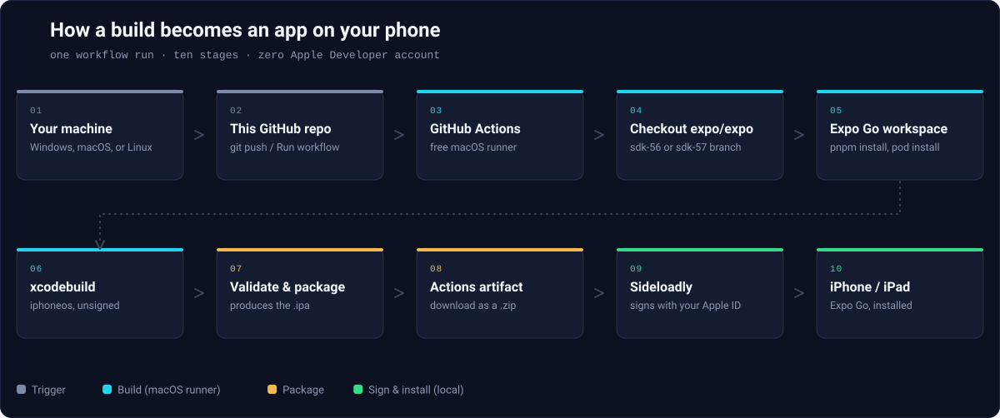

<p align="center">
  
</p>

<h1 align="center">Expo Go iOS Builder</h1>

<p align="center">
  Compile the real, open-source <strong>Expo Go</strong> iOS app from Expo's own source on a free GitHub-hosted Mac,<br/>
  then sideload it yourself with a free tool and a free Apple ID.
</p>

<p align="center">
  
  
  
  
  
</p>

---

## What this project does

This repository is a single GitHub Actions workflow that checks out the real
`expo/expo` source code, compiles the **Expo Go** iOS app on a GitHub-hosted
macOS runner, and hands you back an **unsigned `.ipa` file**. You then sign
and install it yourself with [Sideloadly](https://sideloadly.io/), a free
tool, using your own free Apple ID.

> [!TIP]
> **No Mac. No paid Apple Developer Program membership.** The only things
> you need are a free GitHub account and a free Apple ID — see
> [Requirements](#requirements) below.

## Which SDK do I need?

| Expo SDK | Build support in this repo | Notes |
|:--:|---|---|
| **58** | Available in the workflow | Source and configuration checked; native build and device testing pending. |
| **57** | Built and released | Default selection. Previously built in CI; owner reported successful device use. |
| **56** | Built and released | The patched build succeeded and its IPA was published. |
| **55** | Available in the workflow | Uses Yarn and its own Xcode settings; native build and device testing pending. |
| **54** | Available in the workflow | Uses Yarn and the older plist generator; native build and device testing pending. |

Choose the SDK your Expo project targets. All five versions use the same
workflow; the source branch, runner, Xcode, Node, dependency manager, and
iOS target are selected automatically. See [SDK support and build evidence](docs/SDK_SUPPORT.md)
for the settings and what has actually been tested.

## Quick Start

1. Open this repo's [**Actions** tab](../../actions).
2. Select **"Build Expo Go (unsigned IPA for Sideloadly)"** from the sidebar.
3. Click **Run workflow**.
4. Choose **SDK 54, 55, 56, 57, or 58** from the `expo_sdk` dropdown.
5. Optionally tick **Also publish this build as a GitHub Release**. These
   are the only two build inputs; everything else is automatic. GitHub
   also shows its standard **Use workflow from** branch selector — use `main`.
6. Wait for the build — roughly **60–150 minutes**. You can close the tab;
   the run keeps going.
7. When it finishes, open the run and download the artifact from the
   **Artifacts** section at the bottom.
8. Unzip it once — you'll get a `.ipa` file. **Don't** unzip that part.
9. Open [Sideloadly](https://sideloadly.io/), drag in the `.ipa`, sign in
   with your Apple ID, and install it over USB.

> [!NOTE]
> Full walkthrough, including how to read the logs and rerun a failed
> build: [docs/GITHUB_ACTIONS.md](docs/GITHUB_ACTIONS.md).
> Full signing walkthrough, including trusting the developer profile on your
> device: [docs/IPA_SIGNING.md](docs/IPA_SIGNING.md).

## Requirements

- A GitHub account (the repo can be free/public).
- GitHub Actions enabled on the repo (on by default for a new repo).
- A Windows, macOS, or Linux machine to download the artifact.
- [Sideloadly](https://sideloadly.io/) to sign and install the IPA.
- An iPhone or iPad.
- **A free Apple ID** — no paid Apple Developer Program membership needed
  for any step in this pipeline.

## How it works

<p align="center">
  
</p>

Compilation (needs macOS, not your identity) and signing (needs your Apple
ID, not macOS) are deliberately kept as two separate stages, on two separate
machines. GitHub Actions never sees your Apple credentials, and this
project never asks for them — see [docs/DECISIONS.md](docs/DECISIONS.md)
for why.

<details>
<summary>Prefer a plain-text version of the diagram?</summary>

```
Windows / macOS / Linux developer machine
    ↓
GitHub repository (this repo)
    ↓
GitHub Actions macOS runner (free, unmetered on a public repo)
    ↓
Checkout expo/expo source (sdk-54 through sdk-58, your choice)
    ↓
Expo Go iOS workspace (Yarn or pnpm install, pod install)
    ↓
xcodebuild — physical-device ARM64 build, unsigned
    ↓
Validate & package → .ipa
    ↓
GitHub Actions artifact
    ↓
Sideloadly — signs locally with your free Apple ID
    ↓
iPhone / iPad
```

</details>

Full diagram and explanation: [docs/BUILD_ARCHITECTURE.md](docs/BUILD_ARCHITECTURE.md).

## Releases

Previously built SDK 56 and 57 IPAs are available on this repository's
[Releases page](../../releases). SDK 54, 55, and 58 are now selectable for
source builds; their native compilation and on-device use have not yet
been verified in this builder. Existing releases are preserved.

Running the workflow builds the current upstream branch for your selected
SDK. Each run records the exact upstream commit in its summary and, when
publishing is enabled, the release notes.

The workflow only publishes a Release if you explicitly turn on the
`create_release` option when running it — a normal run just produces a
downloadable Actions artifact.

## Signing with a free Apple ID: what to expect

Free/personal Apple IDs carry Apple-imposed limits that apply no matter what
signs the IPA — Sideloadly can't remove them, and neither can this repo:

| Limit | Detail |
|---|---|
| App validity | Expires after **7 days** — re-sideload the same `.ipa` to refresh, no rebuild needed |
| Concurrent apps | **3** actively-signed apps at a time |
| App ID registrations | **10** per rolling 7-day window |
| Push notifications | ❌ Not available (needs a paid team) |
| Sign In with Apple | ❌ Not available |
| Universal links (`https://expo.dev/...`) | ❌ Not available — the `exp://` scheme used for QR-code scanning is unaffected |
| iCloud-backed features | ❌ Not available |

**What still works:** scanning a QR code, loading your JS bundle via Metro,
the in-app dev menu, fast refresh, and standard Expo SDK functionality — the
actual point of Expo Go for day-to-day development. Full detail:
[docs/IPA_SIGNING.md](docs/IPA_SIGNING.md).

## Development

The entire build pipeline lives in one file:
[`.github/workflows/build-expo-go.yml`](.github/workflows/build-expo-go.yml).
It is the repository's **only workflow**. Its `workflow_dispatch` form has
two inputs: the SDK dropdown (54–58, default 57) and an optional release
checkbox. The old SDK-57-only workflow has been removed.

A configuration job resolves SDK-specific values in one case statement;
the build job then uses the selected macOS runner and tools. SDK 54/55
use Yarn, SDK 56/57 use pnpm 10, and SDK 58 uses pnpm 12.2.1 with Node 24.
The older SDK 54 plist generator is handled separately. See
[docs/SDK_SUPPORT.md](docs/SDK_SUPPORT.md) for source references, build
status, and local validation commands.

> [!IMPORTANT]
> If you're an AI coding agent picking this repo up, **start with
> [docs/AI_CONTEXT.md](docs/AI_CONTEXT.md)** — it explains what not to
> change casually and why.

## Documentation

| Doc | What's in it |
|---|---|
| [docs/AI_CONTEXT.md](docs/AI_CONTEXT.md) | Start here if you're modifying this repo |
| [docs/BUILD_ARCHITECTURE.md](docs/BUILD_ARCHITECTURE.md) | Full pipeline diagram and explanation |
| [docs/SDK_SUPPORT.md](docs/SDK_SUPPORT.md) | SDK 54–58 automatic settings, source verification, and build evidence |
| [docs/SDK_56.md](docs/SDK_56.md) | Verified SDK 56 build configuration |
| [docs/SDK_57.md](docs/SDK_57.md) | Verified SDK 57 build configuration + known working state |
| [docs/GITHUB_ACTIONS.md](docs/GITHUB_ACTIONS.md) | How to run and interpret the workflow |
| [docs/IPA_SIGNING.md](docs/IPA_SIGNING.md) | Sideloadly, free Apple ID limits, trust steps |
| [docs/TROUBLESHOOTING.md](docs/TROUBLESHOOTING.md) | Common failure modes and fixes |
| [docs/DECISIONS.md](docs/DECISIONS.md) | Why the repo is built the way it is |

## Limitations & things to know

- **The output IPA is unsigned by design.** It cannot be installed as-is —
  it must be signed first with Sideloadly or another local-signing tool.
  See [docs/IPA_SIGNING.md](docs/IPA_SIGNING.md).
- **SDK/Expo Go version matching matters.** A project built for SDK 57
  needs an SDK-57 Expo Go build, and vice versa — see
  [docs/TROUBLESHOOTING.md](docs/TROUBLESHOOTING.md#sdk-mismatch).
- **Native modules not present in Expo Go's own module set** still won't
  work in Expo Go, regardless of how it was built — this is a general Expo
  Go constraint (you'd need a custom dev client for those), not something
  specific to this pipeline.
- **SDK 54, 55, and 58 need their first native build verification in this
  builder.** Local configuration checks do not prove that an IPA compiles
  or installs; see [docs/SDK_SUPPORT.md](docs/SDK_SUPPORT.md).
- **SDK 56's SceneGeometry workaround remains conditional.** The patched
  build was successfully released; the patch is skipped if upstream has
  supplied the utility. See [docs/SDK_56.md](docs/SDK_56.md).

> [!WARNING]
> This project is an independent, community-built tool. It is not
> affiliated with, endorsed by, or sponsored by Apple Inc. or Expo (650
> Industries, Inc.). "Expo," "Expo Go," "iPhone," "iPad," and "Xcode" are
> trademarks of their respective owners.

## Contributing

Issues and PRs are welcome — see [docs/DECISIONS.md](docs/DECISIONS.md) for
the reasoning behind the current design before proposing structural
changes, and [docs/AI_CONTEXT.md](docs/AI_CONTEXT.md) if you're using an AI
agent to help. No `LICENSE` file is included yet; treat contributions as
"ask first" for reuse until one is added.

If this repo saved you the price of a Mac, a ⭐ helps other developers find
it.
