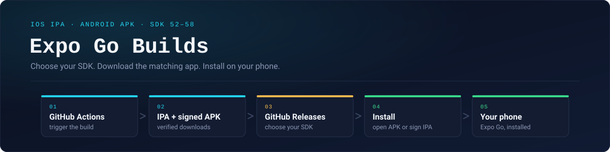
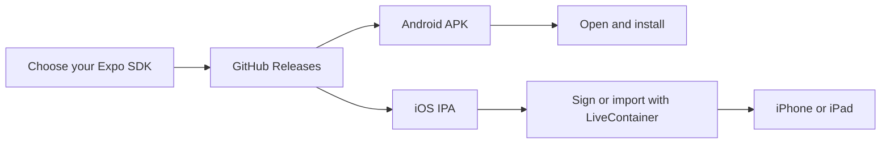
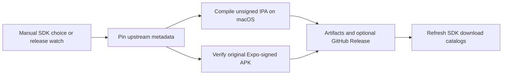

<p align="center">
  
</p>

<h1 align="center">Expo Go Builds</h1>
<p align="center">Your SDK. Your phone.<br/>Community-built iOS IPAs and original Expo-signed Android APKs.</p>
<p align="center">
  <a href="https://expo-go-builds.vercel.app"><strong>Choose your SDK on the website →</strong></a><br/>
  <a href="https://github.com/Vaibhavsh0120/Expo-Go-IOS-IPA-Builder/releases">GitHub Releases</a> ·
  <a href="#livecontainer-source">LiveContainer source</a> ·
  <a href="#github-actions">Build with Actions</a>
</p>

## Download and install

**Start with [GitHub Releases](https://github.com/Vaibhavsh0120/Expo-Go-IOS-IPA-Builder/releases)** or the [download website](https://expo-go-builds.vercel.app).
Choose the SDK your Expo project uses, then download its file under **Assets**.

| Your device | Download | Install |
|---|---|---|
| **Android** | `ExpoGo-SDKN.apk` | Open the APK and allow installation from your browser or file manager. |
| **iPhone / iPad** | `ExpoGo-SDKN-unsigned.ipa` | Import with LiveContainer or [sign locally](docs/IPA_SIGNING.md) using a compatible tool. |

Android APKs retain Expo’s original signature and are mirrored without modification.
iOS IPAs are compiled from Expo’s open source code on a GitHub-hosted Mac.
The IPA needs signing; tapping it alone does not install it.



## LiveContainer source

Add this one URL in **LiveContainer → Sources → +**, then select the SDK you need:

```text
https://raw.githubusercontent.com/Vaibhavsh0120/Expo-Go-IOS-IPA-Builder/main/apps.json
```

Each published SDK is a separate entry. A newer SDK keeps the older choices available;
each entry updates within its own SDK. Only verified published IPAs appear.
All builds share Expo Go’s bundle identifier; use LiveContainer’s duplicate controls
when keeping multiple copies. [Source and installation guide →](docs/LIVECONTAINER.md)

## Supported SDKs

| Expo SDK | Support | SDK information |
|:--:|:--:|---|
| **58** | ✅ | React Native 0.88 · iOS 16.4+ · [Notes](releases/sdk-58.md) |
| **57** | ✅ | React Native 0.86 · iOS 16.4+ · [Notes](releases/sdk-57.md) |
| **56** | ✅ | React Native 0.85 · iOS 16.4+ · [Notes](releases/sdk-56.md) |
| **55** | ✅ | React Native 0.83 · iOS 15.1+ · [Notes](releases/sdk-55.md) |
| **54** | ✅ | React Native 0.81 · iOS 15.1+ · [Notes](releases/sdk-54.md) |
| **53** | ✅ | React Native 0.79 · iOS 15.1+ · [Notes](releases/sdk-53.md) |
| **52** | ✅ | React Native 0.76 · iOS 15.1+ · [Notes](releases/sdk-52.md) |

Android requires Android 7.0+ for the currently verified APKs. Ticks indicate published IPA and APK downloads; [actual build and device evidence](docs/SDK_SUPPORT.md#build-and-device-evidence)
is recorded separately. The website enables downloads only after files are published.

## GitHub Actions

Most people can use **Releases**. To prepare a fresh pair:

1. Open [**Actions → Build Expo Go**](https://github.com/Vaibhavsh0120/Expo-Go-IOS-IPA-Builder/actions/workflows/build-expo-go.yml) and click **Run workflow** on `main`.
2. Choose SDK **52–58**.
3. Optionally tick **Also publish this build as a GitHub Release**, then run it.

Those are the only two inputs. Source, Xcode, runner, and dependency settings are automatic.
Successful platform jobs upload artifacts for 30 days. Release publishing waits for both
platforms and includes SDK notes, source commits, sizes, checksums, and APK verification.

The **same single workflow** checks official stable Expo Go versions every six hours.
A new or changed supported SDK release starts an IPA build and prepares its official APK.
Unchanged versions do not trigger another native build. Future SDKs need reviewed native
toolchain settings before automatic builds can support them.
[Actions guide →](docs/GITHUB_ACTIONS.md)



## Useful links

[SDK release notes](releases/README.md) · [Signing](docs/IPA_SIGNING.md) ·
[Troubleshooting](docs/TROUBLESHOOTING.md) · [Build settings](docs/SDK_SUPPORT.md) ·
[Contributing](docs/CONTRIBUTING.md) · [Website development](web/README.md)

Match the SDK to your project. Custom native modules may require an
[Expo development build](https://docs.expo.dev/develop/development-builds/introduction/).
Free Apple ID signing has Apple-imposed limits; keep your credentials on your own machine.

Independent community project, unaffiliated with Expo or Apple.
[Official Expo Go →](https://expo.dev/go) · [Expo source →](https://github.com/expo/expo)

No license has been selected for this repository’s own code; ask before reusing it.
