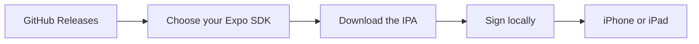

<p align="center">
  
</p>

<h1 align="center">Expo Go iOS Builder</h1>

<p align="center">
  Compile the real, open-source <strong>Expo Go</strong> iOS app from Expo's own source on a free GitHub-hosted Mac,<br/>
  then sideload it yourself with a free tool and a free Apple ID.
</p>

<p align="center">
  
  
  
  
  
</p>

---

## Install from LiveContainer

Add this source in **LiveContainer → Sources → +**, then choose **Expo Go
SDK 54, 55, 56, 57, or 58** from the published versions shown:

```text
https://raw.githubusercontent.com/Vaibhavsh0120/Expo-Go-IOS-IPA-Builder/main/apps.json
```

**[Open source JSON](https://raw.githubusercontent.com/Vaibhavsh0120/Expo-Go-IOS-IPA-Builder/main/apps.json)**
· [LiveContainer guide](docs/LIVECONTAINER.md)

Each SDK has its own entry, so you can select the version your project
needs. The source refreshes when a new IPA is published. Only published
IPAs appear; use the download option below if you prefer another installer.

## Download an IPA

**Start with [GitHub Releases](https://github.com/Vaibhavsh0120/Expo-Go-IOS-IPA-Builder/releases).**
Choose the Expo SDK your project uses, open that release, and download
`ExpoGo-SDK<version>-unsigned.ipa` from **Assets**.

1. **Download** the matching `.ipa` from Releases.
2. **Sign** it locally with [Sideloadly](https://sideloadly.io/), SideStore,
   or another compatible tool.
3. **Install** it on your iPhone or iPad.

The IPA is unsigned and needs signing before installation.
[Signing walkthrough →](docs/IPA_SIGNING.md)



## Supported SDKs

| Expo SDK | Build support | SDK information |
|:--:|:--:|---|
| **58** | ✅ | React Native 0.88 · iOS 16.4+ · [Release notes](releases/sdk-58.md) |
| **57** | ✅ | React Native 0.86 · iOS 16.4+ · Default build selection · [Release notes](releases/sdk-57.md) |
| **56** | ✅ | React Native 0.85 · iOS 16.4+ · Includes the conditional SceneGeometry fix · [Release notes](releases/sdk-56.md) |
| **55** | ✅ | React Native 0.83 · iOS 15.1+ · [Release notes](releases/sdk-55.md) |
| **54** | ✅ | React Native 0.81 · iOS 15.1+ · [Release notes](releases/sdk-54.md) |

The ticks indicate builder support. Download availability depends on which
IPAs have been published. [SDK release dates](releases/README.md) ·
[Build and device verification](docs/SDK_SUPPORT.md#build-and-device-evidence)

## Build your own with GitHub Actions

If the IPA you need is not in Releases, or you want a fresh upstream build:

1. Open [**Actions → Build Expo Go**](https://github.com/Vaibhavsh0120/Expo-Go-IOS-IPA-Builder/actions/workflows/build-expo-go.yml).
2. Click **Run workflow** and keep **Use workflow from** set to `main`.
3. Choose SDK **54, 55, 56, 57, or 58**.
4. Tick **Also publish this build as a GitHub Release** to make the IPA
   available on the Releases page too.
5. Click **Run workflow** and wait for it to finish.

Those are the only two build inputs. Source, runner, Xcode, and dependency
tools are selected automatically. There is **one workflow** for every SDK.

Every successful build uploads an Actions artifact, retained for 30 days.
Unzip that artifact once to get the `.ipa`. With the release checkbox
selected, the IPA is also attached directly to a new GitHub Release with
SDK-specific notes and build details. Existing releases are preserved.
Earlier builds took roughly 60–150 minutes; cold caches and new SDKs can
vary. [Full Actions guide →](docs/GITHUB_ACTIONS.md)

## How the builder works

The workflow compiles the real, open-source Expo Go app from `expo/expo`
on a GitHub-hosted Mac. It produces an unsigned physical-device IPA;
signing happens locally with your own Apple ID. No Mac or paid Apple
Developer Program membership is needed to compile it this way.

<p align="center">
  
</p>

[Build architecture →](docs/BUILD_ARCHITECTURE.md)

## Before installing

- Match the Expo Go SDK to your project's Expo SDK.
- Free Apple ID signing has Apple-imposed limits, including a seven-day
  validity period. See the [signing guide](docs/IPA_SIGNING.md).
- Native modules outside Expo Go's module set require a development build.
- Keep Apple credentials on your own machine. This workflow never asks
  for them.

## Documentation

| Guide | What it covers |
|---|---|
| [Release notes](releases/README.md) | Each SDK's features, compatibility, and original release date |
| [LiveContainer](docs/LIVECONTAINER.md) | Add the source, select an SDK, and understand installation behavior |
| [GitHub Actions](docs/GITHUB_ACTIONS.md) | Build inputs, artifacts, logs, and reruns |
| [Signing](docs/IPA_SIGNING.md) | Sign and install the IPA locally |
| [Troubleshooting](docs/TROUBLESHOOTING.md) | SDK mismatch, dependency, Xcode, and signing failures |
| [SDK settings and evidence](docs/SDK_SUPPORT.md) | Automatic toolchains and actual verification status |
| [Contributing / AI context](docs/AI_CONTEXT.md) | Constraints to read before editing the builder |
| [Decisions](docs/DECISIONS.md) | Why the pipeline is structured this way |

This is an independent community project, unaffiliated with Expo or Apple.
Issues and pull requests are welcome. No license has been selected yet;
ask before reusing this repository's own code.
