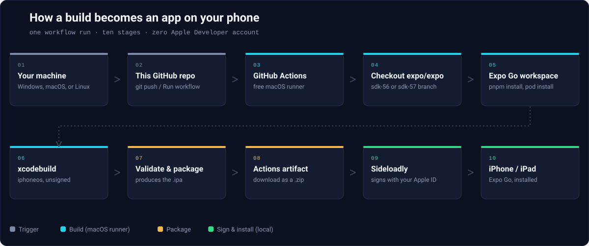

# BUILD_ARCHITECTURE.md

<p align="center">
  
</p>

## End-to-end pipeline

```
Windows developer machine
    │  (or macOS/Linux — nothing about triggering the workflow is
    │   platform-specific; this repo assumes Windows only for the final
    │   Sideloadly signing step)
    ▼
GitHub repository (this repo)
    │  git push, or just click "Run workflow" in the Actions UI
    ▼
Resolve SDK configuration (Linux job, automatic)
    ▼
GitHub Actions macOS runner (macos-15 or macos-26)
    │  free + unmetered on a PUBLIC repo
    ▼
Checkout expo/expo source (a DIFFERENT repo, fetched fresh each run)
    │  branch selected by the expo_sdk input: sdk-54 through sdk-58
    ▼
Expo Go iOS workspace (apps/expo-go/ios/Exponent.xcworkspace)
    │  Yarn or pnpm install, react-native-lab setup, pod install
    ▼
Xcode (preferred version selected automatically for the SDK)
    │  xcodebuild -sdk iphoneos -destination generic/platform=iOS
    │  CODE_SIGNING_ALLOWED=NO (no Apple Developer account needed)
    ▼
Physical-device ARM64 build (Expo Go.app)
    │  verified: lipo -info, otool, PlistBuddy, codesign -dvvv
    ▼
Unsigned .ipa (Payload/Expo Go.app zipped)
    │  ExpoGo-SDK<N>-unsigned.ipa (N = 54, 55, 56, 57, or 58)
    ▼
GitHub Actions artifact (ExpoGo-SDK<N>-iOS)
    │  downloaded by you, as a .zip wrapper around the .ipa
    │  (optionally, opt-in: also published as a GitHub Release)
    ▼
Sideloadly (on your Windows machine)
    │  signs the unsigned .ipa with your free/personal Apple ID
    ▼
iPhone / iPad
    │  install via Sideloadly's USB flow, then trust the developer
    │  profile in Settings → General → VPN & Device Management
    ▼
Expo Go running on your device
```

## Why the actual iOS compilation happens on macOS

Xcode — and specifically `xcodebuild`, which is what actually compiles
Objective-C/Swift/C++ into a Mach-O binary and links the `.app` bundle —
is a macOS-only toolchain. Apple does not ship Xcode, or the iOS SDK
headers/frameworks `xcodebuild` links against, for Windows or Linux. There
is no way to produce a real `iphoneos`-target binary without running the
actual compiler on actual macOS.

This is why the pipeline's one hard requirement is a macOS build host —
and why this repo uses GitHub's hosted `macos-15` / `macos-26` runners rather than
requiring you to own a Mac. GitHub-hosted macOS runners are real (virtualized)
Apple hardware/OS, running the genuine Xcode toolchain, so the resulting
binary is a real, correctly-linked iOS binary — not a cross-compiled or
emulated approximation.

Everything *after* that compilation step (signing with Sideloadly,
installing via USB) is intentionally designed to run on Windows, because
signing with a free/personal Apple ID doesn't require Xcode at all —
Sideloadly reimplements just enough of Apple's signing protocol to do that
part cross-platform. See [IPA_SIGNING.md](IPA_SIGNING.md) for why signing
is deliberately kept out of the macOS/CI part of this pipeline.

## Single workflow, SDK-parameterized

SDKs 54–58 share one workflow and the same unsigned physical-device
build/package sequence. The Linux configuration job resolves the selected
SDK before the macOS build job starts, so runner and toolchain settings
have one source of truth.

SDK 54/55 use Yarn Classic and macOS 15. SDK 56/57 use pnpm 10 on macOS 26.
SDK 58 uses pnpm 12.2.1 with Node 24. SDK 54's older plist generator gets
its required Xcode environment; later SDKs use the shell generator.
See [SDK_SUPPORT.md](SDK_SUPPORT.md) for the complete configuration and
source evidence.
